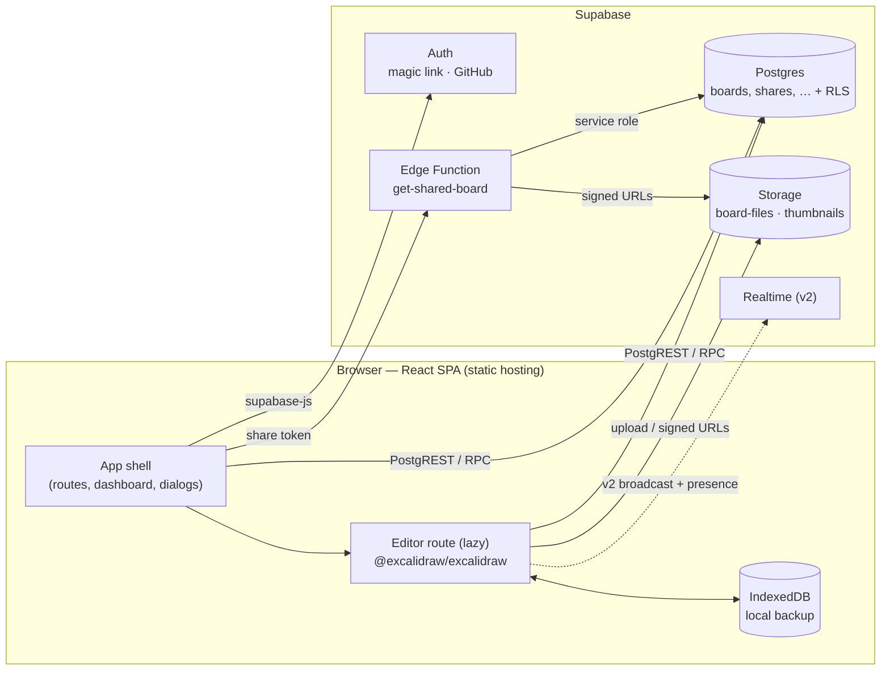

# Uncle Draw — Technical Requirements

> Status: Draft v0.1 · Last updated: 2026-10-13
> Companion docs: [VISUAL_DESIGN.md](./VISUAL_DESIGN.md) · [FEATURES.md](./FEATURES.md)

## 1. Overview

**Uncle Draw** is a web whiteboard in the spirit of Excalidraw: an infinite canvas with a hand-drawn look, where every board is saved to the user's account in **Supabase**.

We don't write a canvas engine. We embed the open-source **`@excalidraw/excalidraw`** React component (MIT) and build the product around it: accounts, a board dashboard, cloud persistence, share links and our own branding.

### How the hand-drawn feel is kept
The look comes from Excalidraw's renderer, so it stays intact as long as we don't fight it:

| Ingredient | Where it comes from |
|---|---|
| Sketchy shapes (wobbly lines, hachure fills) | Excalidraw renders every element through **Rough.js** with a per-element `seed`, so a shape looks the same every time it is drawn |
| Handwritten text | **Excalifont**, Excalidraw's default font (font family id `5`); **Virgil** (id `1`) is available too |
| Pressure-sensitive pen strokes | Excalidraw's freedraw tool (based on perfect-freehand) |
| Sketchy app shell (dashboard, dialogs) | Our own components, drawn with **`roughjs`** (see [VISUAL_DESIGN.md](./VISUAL_DESIGN.md)) |

Hard rule: **never store rendered output** (PNG/SVG) as the source of truth. We store Excalidraw's element JSON and let Excalidraw render it, so the sketchy look stays deterministic and editable.

### v1 scope (summary)
- Sign in with an email magic link or GitHub.
- Create, rename and delete boards; edit them in the embedded Excalidraw editor. (Duplicate, trash and search come in v1.1.)
- Autosave to Supabase with an offline-safe local backup.
- Images uploaded to Supabase Storage.
- Read-only share links.
- **Not in v1:** real-time multiplayer (planned for v2, see §15).

See [FEATURES.md](./FEATURES.md) for the full list with priorities.

---

## 2. Architecture



- **Frontend:** a single-page app (React + Vite), deployed as static files to Vercel, Netlify or Cloudflare Pages (all routes rewrite to `index.html`).
- **Backend:** Supabase only. The browser talks to Postgres through `supabase-js`, and Row Level Security (RLS) enforces access. The only server-side code we own is one Edge Function for share links.
- **No custom API server** in v1.

---

## 3. Tech stack

Versions were current on npm on 2026-10-13. Pin exact versions in `package.json` and commit the lockfile.

| Concern | Choice | Version | Notes |
|---|---|---|---|
| UI framework | React | 19.x | Excalidraw 0.18.1 peer range: `^17.0.2 \|\| ^18.2.0 \|\| ^19.0.0` |
| Build tool | Vite | 8.x | SPA mode |
| Language | TypeScript | 7.x | `strict: true`, `noUncheckedIndexedAccess: true` |
| Canvas editor | `@excalidraw/excalidraw` | **0.18.1 (exact pin, no `^`)** | 0.x: minor releases may break the API, so upgrade deliberately |
| Backend client | `@supabase/supabase-js` | 2.x (2.117.3) | |
| Routing | React Router | 8.x | Library mode (no framework/SSR features) |
| Server state | TanStack Query | 5.x | Dashboard lists, board metadata, signed URL caching |
| Shell styling | Tailwind CSS | 4.x | App shell only, never inside `.excalidraw` |
| Sketchy shell UI | `roughjs` | 4.6.x | Borders and underlines for shell components |
| Icons | `@tabler/icons-react` | 3.x | Matches Excalidraw's icon style |
| Shell fonts | `@fontsource-variable/assistant` + a bundled Excalifont Latin subset | — | Assistant is Excalidraw's UI font; see [VISUAL_DESIGN.md](./VISUAL_DESIGN.md) §4 |
| Local cache | `idb-keyval` | 6.x | IndexedDB key-value store |
| Validation | Zod | 4.x | Validate scenes loaded from DB, files and share responses |
| Unit tests | Vitest + Testing Library | 5.x | |
| E2E tests | Playwright | 1.64.x | |
| Backend tooling | Supabase CLI | 2.x | Local stack, migrations, type generation, `test db` |
| Lint / format | ESLint + Prettier | latest | |

---

## 4. Excalidraw integration

Everything below was checked against the published type definitions of `@excalidraw/excalidraw@0.18.1`.

### 4.1 Setup
- Import the stylesheet once: `import "@excalidraw/excalidraw/index.css";`
- **Self-host fonts.** By default Excalidraw downloads fonts from `https://esm.sh/@excalidraw/excalidraw@<version>/dist/prod/`. We serve them ourselves instead:
  1. At build time, copy `node_modules/@excalidraw/excalidraw/dist/prod/fonts/` to `public/excalidraw-assets/fonts/` (with `vite-plugin-static-copy` or a `postinstall` script).
  2. Before Excalidraw loads, set `window.EXCALIDRAW_ASSET_PATH = window.location.origin + "/excalidraw-assets/";`.
  3. The folder is about 13 MB, mostly CJK fallback subsets (Xiaolai) that load only when those characters appear. Excalifont, Nunito and the others are small `woff2` subsets.
- **Lazy-load the editor.** `/b/:boardId` and `/s/:token` load `EditorPage` and `SharePage` with `React.lazy`, so the Excalidraw bundle stays out of the dashboard's initial load.
- The Excalidraw container must have an explicit size (`height: 100dvh`).

### 4.2 Component props we use

| Prop / API | Purpose |
|---|---|
| `excalidrawAPI={(api) => …}` | Get the imperative API (`updateScene`, `getSceneElements`, `getAppState`, `getFiles`, `addFiles`, `scrollToContent`, `resetScene`) |
| `initialData` | A promise resolving to `{ elements, appState, files }`, built from the DB scene after `restore()` |
| `onChange(elements, appState, files)` | Drives autosave, the local backup and file uploads (§7) |
| `theme` | `"light"` or `"dark"`, synced with the app theme setting |
| `viewModeEnabled` | `true` on the share page (read-only) |
| `UIOptions` | `canvasActions: { loadScene: false, saveToActiveFile: false }`. We import from the dashboard (IO-3), and Ctrl/Cmd+S forces a cloud save (§7.2) |
| `renderTopRightUI` | Save-status pill, Share button and avatar |
| `<MainMenu>` children | Custom menu: Back to boards, Rename, Share, plus the default items we keep |
| `<WelcomeScreen>` children | Branded empty-canvas hints |
| `onLibraryChange` / `initialData.libraryItems` | Sync the personal library (v1.1) |
| `langCode` | `"en"` for v1 |

### 4.3 Exported helpers we use

| Helper | Use |
|---|---|
| `restore(data, localAppState, localElements)` / `restoreElements` / `restoreAppState` | **Always** run on load. It migrates old element schemas and fills in missing fields |
| `serializeAsJSON(elements, appState, files, "database")` | Produces the DB payload. With `"database"`, only `gridModeEnabled`, `gridSize`, `gridStep` and `viewBackgroundColor` are kept from `appState`, and `files` is omitted |
| `getNonDeletedElements` | Strip deleted elements (tombstones) before saving in v1 (§15 explains the v2 change) |
| `hashElementsVersion` | Cheap fingerprint used to skip no-op saves. **`getSceneVersion` is deprecated in 0.18; don't use it** |
| `exportToBlob` / `exportToSvg` | Thumbnails (§7.5) and user exports |
| `loadFromBlob` | Importing `.excalidraw` files as new boards (v1.1) |
| `reconcileElements` | v2 multiplayer merge (§15) |
| `FONT_FAMILY`, `THEME`, `MIME_TYPES`, `CaptureUpdateAction` | Constants. Use `CaptureUpdateAction.NEVER` for remote or programmatic `updateScene` calls that shouldn't enter undo history |

### 4.4 What we persist

| Data | Where | Why |
|---|---|---|
| Elements (non-deleted) | `boards.scene` (jsonb) | Source of truth for the drawing |
| Shared canvas settings (`viewBackgroundColor`, grid settings) | `boards.app_state` (jsonb) | Part of the board's look |
| Image binaries | Storage `board-files` + `board_files` table | Keeps large data URLs out of Postgres |
| Viewport (`scrollX`, `scrollY`, `zoom`) and the last-used style (`currentItem*`) | IndexedDB, per user | Personal UI state; must not leak to other viewers in v2 |
| Scene schema version | `boards.scene_schema_version` | Lets us run our own migrations later; Excalidraw's `restore()` handles its own |

---

## 5. Data model

All tables are in the `public` schema and all foreign keys to users point at `auth.users(id) on delete cascade`. Migrations live in `supabase/migrations/`.

```sql
-- Profiles: one row per user, created by trigger on auth.users insert.
create table public.profiles (
  id           uuid primary key references auth.users(id) on delete cascade,
  display_name text,
  avatar_url   text,                      -- from GitHub, if available
  created_at   timestamptz not null default now()
);

-- Boards: one Excalidraw scene each.
create table public.boards (
  id                   uuid primary key default gen_random_uuid(),
  owner_id             uuid not null default auth.uid() references auth.users(id) on delete cascade,
  title                text not null default 'Untitled board'
                         check (char_length(title) between 1 and 200),
  scene                jsonb not null default '{"elements":[]}'::jsonb,
  app_state            jsonb not null default '{}'::jsonb,
  scene_schema_version int  not null default 1,
  version              int  not null default 1,   -- optimistic concurrency, bumped only by save_board()
  thumbnail_path       text,                      -- path in the thumbnails bucket
  created_at           timestamptz not null default now(),
  updated_at           timestamptz not null default now(),
  deleted_at           timestamptz                -- soft delete (trash)
);
create index boards_owner_updated_idx
  on public.boards (owner_id, updated_at desc) where deleted_at is null;

-- Image files referenced by image elements (element.fileId).
create table public.board_files (
  board_id     uuid not null references public.boards(id) on delete cascade,
  file_id      text not null,                     -- Excalidraw FileId
  owner_id     uuid not null default auth.uid() references auth.users(id) on delete cascade,
  storage_path text not null,                     -- {owner_id}/{board_id}/{file_id}
  mime_type    text not null,
  size_bytes   int  not null check (size_bytes <= 5 * 1024 * 1024),
  created_at   timestamptz not null default now(),
  primary key (board_id, file_id)
);

-- Read-only share links.
create table public.board_shares (
  id          uuid primary key default gen_random_uuid(),
  board_id    uuid not null references public.boards(id) on delete cascade,
  token       text not null unique,               -- 32 random bytes, base64url (43 chars)
  role        text not null default 'viewer' check (role in ('viewer')),
  created_by  uuid not null default auth.uid() references auth.users(id) on delete cascade,
  created_at  timestamptz not null default now(),
  expires_at  timestamptz,                        -- null = never
  revoked_at  timestamptz                         -- null = active
);
-- At most one active link per board (SHARE-1).
create unique index board_shares_one_active_idx
  on public.board_shares (board_id) where revoked_at is null;

-- Personal Excalidraw library (v1.1).
create table public.user_libraries (
  user_id    uuid primary key default auth.uid() references auth.users(id) on delete cascade,
  items      jsonb not null default '[]'::jsonb,
  updated_at timestamptz not null default now()
);
```

**Storage buckets** (both private):

| Bucket | Object path | Contents |
|---|---|---|
| `board-files` | `{owner_id}/{board_id}/{file_id}` | Images placed on boards |
| `thumbnails` | `{owner_id}/{board_id}.webp` | Dashboard previews |

**Save RPC.** The editor saves only through this function, so the version check is atomic:

```sql
create function public.save_board(
  p_board_id uuid, p_expected_version int, p_scene jsonb, p_app_state jsonb
) returns int                      -- new version, or null on conflict / not found
language sql security invoker      -- RLS still applies
as $$
  update public.boards
     set scene = p_scene, app_state = p_app_state,
         version = version + 1, updated_at = now()
   where id = p_board_id
     and version = p_expected_version
     and deleted_at is null
  returning version;
$$;
```

Rules:
- Renaming (`title`), soft delete and thumbnail updates are plain `update`s. They **do not** bump `version`, so a rename never causes a save conflict. A trigger keeps `updated_at` current on every update.
- Duplicating a board copies `scene`, `app_state` and the `board_files` rows. Storage objects are copied server-side with `storage.from('board-files').copy()`.

---

## 6. Security and Row Level Security

1. **RLS is enabled on every table.** A table without policies is unreachable, and that is the default stance.
2. **Owner-only policies:**
   ```sql
   alter table public.boards enable row level security;
   create policy "owner can do everything" on public.boards
     for all to authenticated
     using (owner_id = (select auth.uid()))
     with check (owner_id = (select auth.uid()));
   ```
   Apply the same pattern to `board_files` (`owner_id`), `board_shares` (`created_by` **and** the board is owned by the caller), `user_libraries` (`user_id`) and `profiles` (`id`; select and update only).
3. **Storage policies** scope objects to the user's own folder:
   ```sql
   create policy "own folder" on storage.objects
     for all to authenticated
     using (bucket_id in ('board-files','thumbnails')
            and (storage.foldername(name))[1] = (select auth.uid())::text)
     with check (bucket_id in ('board-files','thumbnails')
            and (storage.foldername(name))[1] = (select auth.uid())::text);
   ```
4. **Share links never touch RLS.** The Edge Function `get-shared-board`:
   1. Takes `{ token }`.
   2. Uses the **service-role** client, which exists only inside the function.
   3. Finds an active share: `revoked_at is null and (expires_at is null or expires_at > now())`, on a board where `deleted_at is null`.
   4. Returns `{ title, scene, app_state, files: [{ id, mimeType, url }], updated_at }`, where `url` is a signed URL valid for 10 minutes.
   5. Sends `Cache-Control: no-store`. Unknown, revoked and expired tokens all get the same `404`.
5. **Tokens** come from `crypto.getRandomValues` (32 bytes). Their 256 bits of entropy make guessing infeasible, so v1 has no extra rate limiting.
6. **Keys.** The client bundle contains only `VITE_SUPABASE_URL` and the anon (publishable) key. The service-role key is set only as an Edge Function secret.
7. **Input validation.** Zod schemas check the shape of everything loaded from the DB, the share function and imported files before it reaches `restore()`. Uploaded images: `image/png`, `image/jpeg`, `image/webp`, `image/gif` or `image/svg+xml`, at most 5 MB. SVGs are rendered by Excalidraw as `` sources, never inlined into the DOM.
8. **Embeds.** Set the `validateEmbeddable` prop to an allow-list (YouTube, Vimeo, Figma, GitHub Gist) so boards can't embed arbitrary iframes.

---

## 7. Persistence and sync

### 7.1 Load flow (`/b/:boardId`)
1. Fetch the board row (`scene`, `app_state`, `version`, `title`) and its `board_files` rows in parallel.
2. Read the IndexedDB entry `ud:{userId}:board:{boardId}`, if there is one.
3. If the local entry has a newer `localSavedAt` than the server's `updated_at` **and** a different `hashElementsVersion`, show the recovery prompt: "You have unsaved changes from {time}. Restore them?"
4. Pass the chosen scene through `restore()` and give it to `initialData`.
5. Fetch signed URLs for files, then call `api.addFiles([...])` with `{ id, mimeType, dataURL, created }`. Images show a placeholder until their file arrives.

### 7.2 Autosave
- `onChange` fires on every pointer move, so filter first:
  1. Compute `hashElementsVersion(elements)` and the `app_state` subset. If both match the last saved values, do nothing.
  2. Otherwise **write to IndexedDB right away** (cheap) and schedule a server save.
- Server save is **debounced 1.5 s after the last change, with a forced save after at most 10 s** of continuous editing.
- Only **one save in flight** at a time. Changes made during a save are queued and coalesced into the next one.
- Payload: `JSON.parse(serializeAsJSON(getNonDeletedElements(elements), appState, {}, "database"))`, split into `scene` (elements) and `app_state`.
- Call `rpc('save_board', { p_board_id, p_expected_version, p_scene, p_app_state })`:
  - **Number returned:** store it as the new expected version. Status becomes **Saved**.
  - **`null` returned:** a conflict, meaning the board changed in another tab or device. Stop autosaving and show "This board was changed somewhere else" with two choices: **Reload** (discard local) or **Keep mine** (refetch the version and overwrite).
  - **Network error:** status becomes **Offline**. Retry with exponential backoff (2 s → 30 s cap) and retry right away on the `online` event.
- **Ctrl/Cmd+S** is caught by a capture-phase `keydown` listener on the editor wrapper. It calls `preventDefault()` and flushes the save queue right away.
- On `visibilitychange` to hidden, flush the pending save. `beforeunload` shows the browser prompt only if a save is still pending **and** the IndexedDB write failed.

### 7.3 Save status
The `renderTopRightUI` pill shows one of these states:

| State | Meaning |
|---|---|
| `saved` | Server has the latest version |
| `saving` | A request is in flight or debouncing |
| `offline` | Server unreachable; changes are safe in this browser |
| `error` | Unexpected failure (e.g. RLS denied, payload too large). Shows a retry action |
| `conflict` | Version mismatch; autosave paused (see above) |

### 7.4 Images
- In `onChange`, compare the `files` keys with the set of uploaded file ids. For each new one:
  1. Convert the data URL to a `Blob`.
  2. If it is larger than 2048 px on either side or over 5 MB, downscale it on a canvas, re-encode it as WebP and replace the file through `addFiles`.
  3. Upload it to `board-files/{userId}/{boardId}/{fileId}` with `upsert: false`, then insert the `board_files` row.
- Uploads run in their own queue, separate from scene saves. A scene may reference a file that is still uploading; the load flow tolerates missing files.
- Deleting an image element does **not** delete the file right away (undo still needs it). An orphan cleanup job (v1.1, an Edge Function on a cron schedule) removes `board_files` that no element of the board has referenced for 7 days.

### 7.5 Thumbnails
- Generate with `exportToBlob({ elements, appState: { ...appState, exportBackground: true, exportWithDarkMode: false }, files, mimeType: "image/webp", maxWidthOrHeight: 480 })`. Thumbnails are always light; [VISUAL_DESIGN.md](./VISUAL_DESIGN.md) §3.3 explains why.
- Generate **at most once a minute** while the board is changing, and again when leaving the editor route.
- Upload to `thumbnails/{userId}/{boardId}.webp` with `upsert: true`, then set `boards.thumbnail_path`.
- The dashboard requests signed URLs in one batch (`createSignedUrls`, 1 h expiry). TanStack Query caches them for 50 min, keyed on `updated_at` so a new thumbnail breaks the cache.

### 7.6 Local cache (IndexedDB)
- Keys:
  - `ud:{userId}:board:{boardId}`: `{ elements, appState, localSavedAt, serverVersion }`
  - `ud:{userId}:viewport:{boardId}`: `{ scrollX, scrollY, zoom }`
  - `ud:{userId}:prefs`: last-used styles and theme
- Every read and write is wrapped in try/catch. If IndexedDB is unavailable (private mode), autosave still works; we only lose the offline backup and show a one-time notice.
- On sign-out, delete every key under `ud:{userId}:`.

---

## 8. Authentication

| Method | Supabase setting | Notes |
|---|---|---|
| Email magic link | Email provider, OTP/magic link enabled, password sign-in disabled | `signInWithOtp({ email, options: { emailRedirectTo: origin + "/auth/callback" } })` |
| GitHub OAuth | GitHub provider with OAuth app client id and secret | `signInWithOAuth({ provider: "github", options: { redirectTo: origin + "/auth/callback" } })` |

- **Redirect allow-list:** `http://localhost:5173/auth/callback`, preview deploy URLs (wildcard) and the production domain.
- **Session:** `supabase-js` stores the session and refreshes tokens automatically. An `AuthProvider` exposes `session` and `user` and listens to `onAuthStateChange`.
- **Callback:** `/auth/callback` finishes the PKCE exchange, then sends the user to the `next` param they came from (default `/boards`).
- **Route guard:** `/boards` and `/b/:boardId` redirect to `/login?next=…` when there is no session. `/s/:token` is public.
- **Profile:** a trigger on `auth.users` insert creates the `profiles` row, filling `display_name` and `avatar_url` from `raw_user_meta_data` (GitHub) or from the part of the email before the `@`.
- **Account deletion (v1.1, AUTH-6):** an Edge Function `delete-account` uses the service role to remove Storage objects under `{userId}/` and then deletes the auth user. Table rows go with it through the cascades.
- **Email delivery:** configure custom SMTP (e.g. Resend or Postmark) before launch, because Supabase's built-in mailer is heavily rate-limited.

---

## 9. Routes

| Route | Auth | Page |
|---|---|---|
| `/` | public | Redirects to `/boards` when signed in, otherwise to `/login` (a landing page can come later) |
| `/login` | public | Magic link form + "Continue with GitHub" |
| `/auth/callback` | public | Finishes sign-in, then redirects |
| `/boards` | required | Dashboard |
| `/boards/trash` | required | Trash (v1.1, DASH-6) |
| `/b/:boardId` | required | Editor (lazy) |
| `/s/:token` | public | Read-only share view (lazy) |
| `*` | public | 404 |

---

## 10. Performance budgets

| Metric | Budget |
|---|---|
| Shell JS (everything except the editor chunk), gzip | ≤ 200 KB |
| Dashboard LCP on a mid-range laptop over a fast 4G connection | ≤ 2.0 s |
| Opening a 1,000-element board (route change → canvas interactive) | ≤ 2.0 s |
| Autosave overhead per `onChange` (hash + IndexedDB write scheduling) | ≤ 2 ms on average |
| Scene payload | Warn the user at 5 MB; refuse to save above 20 MB with a clear error |
| Dashboard page size | 24 boards per page, then infinite scroll |

---

## 11. Browser and device support

- The latest two major versions of Chrome, Edge, Firefox and Safari (macOS and iPadOS).
- **Desktop first.** Tablets (iPad with Pencil, Android with stylus) must be fully usable; Excalidraw handles touch and pen.
- **Phones:** the editor uses Excalidraw's built-in mobile UI and the dashboard is responsive. Phone editing is supported, but it isn't a design target.
- No IE and no legacy Edge.

---

## 12. Environments and configuration

| Env var | Where | Purpose |
|---|---|---|
| `VITE_SUPABASE_URL` | Client | Project URL |
| `VITE_SUPABASE_ANON_KEY` | Client | Anon (publishable) key |
| `SUPABASE_SERVICE_ROLE_KEY` | Edge Function secrets only | Share and account-deletion functions |
| `SUPABASE_AUTH_GITHUB_CLIENT_ID` / `_SECRET` | `supabase/config.toml` (local) and dashboard (prod) | GitHub OAuth |

Environments:
- **Local:** `supabase start` runs Postgres, Auth, Storage, Mailpit and Functions in Docker. `npm run dev` serves the app at `http://localhost:5173`.
- **Preview:** every PR gets a deploy preview that talks to a **staging** Supabase project.
- **Production:** a separate Supabase project. Migrations are applied by CI with `supabase db push` on merge to `main`.

Generated types: `supabase gen types typescript --local > src/lib/database.types.ts`, run in CI and checked for drift.

---

## 13. Project structure (proposed)

```
uncle-draw/
├─ docs/                          # these documents
├─ public/
│  └─ excalidraw-assets/fonts/    # copied from the Excalidraw package at build time (gitignored)
├─ src/
│  ├─ main.tsx                    # sets EXCALIDRAW_ASSET_PATH, mounts <App/>
│  ├─ app/                        # router, providers (Query, Auth, Theme), AppShell
│  ├─ features/
│  │  ├─ auth/                    # LoginPage, AuthCallback, RequireAuth, useSession
│  │  ├─ boards/                  # DashboardPage, BoardCard, boards.api.ts, boards.queries.ts
│  │  ├─ editor/                  # EditorPage (lazy), useAutosave, serialize.ts, fileSync.ts, thumbnail.ts
│  │  └─ share/                   # SharePage (lazy), ShareDialog, shares.api.ts
│  ├─ components/
│  │  ├─ sketch/                  # SketchBox, SketchButton, SketchInput, SketchDialog (Rough.js)
│  │  └─ ui/                      # non-sketch primitives (Toast, Menu, Avatar)
│  ├─ lib/
│  │  ├─ supabase.ts              # typed client
│  │  ├─ database.types.ts        # generated
│  │  ├─ localCache.ts            # IndexedDB helpers
│  │  └─ schemas.ts               # Zod schemas
│  └─ styles/                     # tokens.css, fonts.css, excalidraw-overrides.css
├─ supabase/
│  ├─ config.toml
│  ├─ migrations/                 # SQL, applied in order
│  ├─ functions/
│  │  ├─ get-shared-board/
│  │  └─ delete-account/
│  └─ tests/                      # pgTAP RLS tests
├─ e2e/                           # Playwright specs
└─ .github/workflows/ci.yml
```

---

## 14. Testing and CI

| Layer | Tooling | What we test |
|---|---|---|
| Unit | Vitest | `serialize.ts` round-trip (save → load → `restore()` gives identical elements), the save-queue state machine (debounce, coalescing, conflict, offline), file diffing, Zod schemas |
| Component | Vitest + Testing Library | Dashboard states (loading, empty, error), ShareDialog, save-status pill |
| Database | `supabase test db` (pgTAP) | Every RLS policy: user A can't read, update or delete user B's boards, files, shares or storage objects; `save_board` conflict behavior |
| Edge Functions | Deno tests | `get-shared-board`: valid, revoked, expired and unknown tokens; deleted board |
| E2E | Playwright against local Supabase | Magic-link login (read the email from Mailpit) → create board → draw rectangle and text → reload → content persists → create share link → open in a logged-out context → read-only → revoke → 404 |

CI (GitHub Actions) on every PR:
1. lint
2. typecheck
3. unit and component tests
4. `supabase start` + `supabase test db`
5. Playwright
6. build
7. bundle-size check against §10

---

## 15. v2: multiplayer readiness

v1 is single-user, but these choices keep v2 cheap:

- **Element identity and versioning are already there.** Every Excalidraw element has `id`, `version` and `versionNonce`. v2 merges remote changes with `reconcileElements(local, remote, appState)` and applies them through `api.updateScene({ elements, captureUpdate: CaptureUpdateAction.NEVER })`.
- **Transport:** a Supabase Realtime channel `board:{boardId}`.
  - **Broadcast** carries element deltas (changed elements only, throttled to about 20 Hz) and pointer positions (`onPointerUpdate`).
  - **Presence** feeds Excalidraw's `collaborators` map (name, avatar, color, pointer, selected ids) and sets `isCollaborating`.
- **Persistence in v2:** one client per board, the oldest in presence, acts as the "saver" and keeps using `save_board`. Everyone else syncs through broadcast. On join, a client loads from the DB and then applies buffered broadcasts.
- **Schema additions:**
  - `board_members (board_id, user_id, role in ('editor','viewer'))`, with RLS widened to "owner **or** member".
  - Channel authorization through Realtime RLS on `realtime.messages`.
- **Known v1 → v2 change:** v1 saves only non-deleted elements. v2 must **keep tombstones** (`isDeleted: true`) so a deletion can't be undone by a stale peer. Prune tombstones older than 24 h when saving.
- **Version history (v2):** a `board_snapshots (board_id, version, scene, created_at)` table, filled at most every 10 min while editing.

---

## 16. Licensing and attribution

- `@excalidraw/excalidraw` is **MIT**. Keep its license text in `THIRD_PARTY_LICENSES.md` and in the About dialog.
- The Excalifont, Virgil, Nunito, Comic Shanns and Xiaolai fonts ship with the package under the **SIL Open Font License**. Self-hosting is allowed; keep the license files next to the fonts.
- **Don't use the "Excalidraw" name or logo** in Uncle Draw's branding. "Built with Excalidraw" in the About dialog and footer is fine.
- `roughjs` is MIT. Tabler Icons are MIT.

---

## 17. Non-goals for v1

- Real-time multiplayer, comments and version history (v2).
- Editor (write) access for anyone other than the owner.
- Teams, workspaces, folders and billing.
- Native mobile apps or a desktop (Electron) build.
- Offline-first editing of boards never opened on this device. We only back up boards that were already opened.
- AI features (text-to-diagram, etc.).
- Server-side rendering and search-engine indexing of shared boards.
